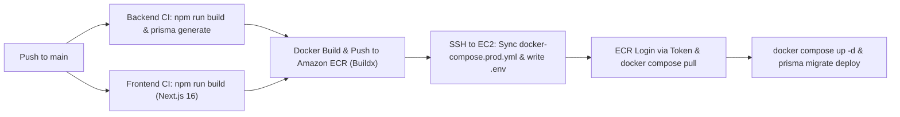

# Mexpo Environment & CI/CD Deployment Guide

This guide documents the complete environment variable setup across all layers of the Mexpo platform, including local development, Docker Compose orchestration, GitHub Actions CI/CD pipeline, and EC2 production deployment.

---

## 📑 Table of Contents
1. [Monorepo Environment Architecture](#monorepo-environment-architecture)
2. [Complete Environment Variables Matrix](#complete-environment-variables-matrix)
3. [Automated GitHub Actions Secrets Setup](#automated-github-actions-secrets-setup)
4. [CI/CD Workflow & Pipeline Execution](#cicd-workflow--pipeline-execution)
5. [Docker Compose & EC2 Production Deployment](#docker-compose--ec2-production-deployment)
6. [Database Switch: Local Docker vs Remote Supabase](#database-switch-local-docker-vs-remote-supabase)

---

## 1. Monorepo Environment Architecture

The project uses a tiered environment configuration:

```
Mexpo/
├── .env                              # Master Docker Compose & Deployment env (Root)
├── .env.example                      # Documented template for the entire stack
├── scripts/
│   ├── import-github-secrets.mjs     # Automated tool to upload .env to GitHub Secrets
│   └── import-github-secrets.ps1     # PowerShell wrapper for automated upload
├── dev-backend-mexpo-new/
│   ├── .env                          # Backend standalone development & testing
│   ├── .env.example                  # Backend template with full docs
│   ├── .env.development              # Dev presets (Supabase pooler + Gmail sandbox)
│   └── .env.production               # Production presets
└── dev-frontend-mexpo-new/
    ├── .env                          # Frontend standalone development (Next.js 16)
    ├── .env.example                  # Frontend template
    ├── .env.development              # Dev presets (localhost:3500)
    └── .env.production               # Production presets (production API)
```

| Layer | File Location | Purpose |
|---|---|---|
| **Root (Docker & Deploy)** | `.env` | Read by `docker-compose.yml`, `docker-compose.prod.yml`, and `scripts/import-github-secrets.*`. |
| **Backend API** | `dev-backend-mexpo-new/.env` | Read by NestJS 11 runtime and Prisma 7 CLI (`prisma migrate`, `prisma db seed`). |
| **Frontend App** | `dev-frontend-mexpo-new/.env` | Read by Next.js 16 (`src/global.ts`). `NEXT_PUBLIC_*` variables are baked in during `next build`. |
| **Production Server** | `/opt/mexpo/app/.env` | Auto-generated by GitHub Actions on EC2 during the deployment step. |

---

## 2. Complete Environment Variables Matrix

### Category 1: Database (PostgreSQL / Supabase)
| Variable | Required | Default / Production Value | Description |
|---|---|---|---|
| `DB_PROVIDER` | Yes | `postgresql` | Database provider (`postgresql` or `mysql`). |
| `DB_HOST` | Yes | `postgres` (or `aws-0-ap-southeast-2.pooler.supabase.com`) | Hostname of the database server. |
| `DB_PORT` | Yes | `5432` (or `6543` for Supabase pooler) | Database connection port. |
| `DB_USER` | Yes | `mexpo_user` (or `postgres.<ref>`) | Database username. |
| `DB_PASSWORD` | Yes | `mexpo_password_2026` | Database password. |
| `DB_NAME` | Yes | `mexpo_db` (or `postgres`) | Database name. |
| `DB_SSLMODE` | No | *(empty)* or `no-verify` | SSL mode. Use `no-verify` for Supabase IPv4 pooler. |

### Category 2: Backend Application (NestJS 11)
| Variable | Required | Default / Production Value | Description |
|---|---|---|---|
| `BACKEND_PORT` | Yes | `3500` | Port NestJS listens on. |
| `NODE_ENV` | Yes | `production` (or `development`) | Node environment mode. |
| `JWT_SECRET` | Yes | `AyamGolek` | App fails fast if unset. Secret for signing JWT bearer tokens. |
| `BASIC_AUTH_USERNAME` | Yes | `bidinCaem` | HTTP Basic Auth username for `/public-api` & `/reports`. |
| `BASIC_AUTH_PASSWORD` | Yes | `bidinGuruSMK` | HTTP Basic Auth password for `/public-api` & `/reports`. |
| `PUBLIC_FRONTEND_URL` | Yes | `https://dev-frontend-expo.4rk4n.dev` | Used for email links (password reset, verification, ticket receipts). |
| `API_BASE_URL` | Yes | `https://dev-backend-expo.4rk4n.dev` | Base public API URL. |
 
### Category 3: SMTP Email Configuration
| Variable | Required | Default / Production Value | Description |
|---|---|---|---|
| `MAIL_HOST` | Yes | `smtp.gmail.com` | SMTP host address. |
| `MAIL_PORT` | Yes | `465` (or `587`) | SMTP port. |
| `MAIL_SECURE` | Yes | `true` (for 465) or `false` (for 587) | TLS flag. |
| `MAIL_USER` | Yes | `your_email@gmail.com` | SMTP sender email. |
| `MAIL_PASSWORD` | Yes | `your_app_password` | SMTP app password. |
| `CONTACT_DESTINATION_EMAIL` | Yes | `tefa@smktelkom-mlg.sch.id` | Recipient inbox for contact messages (`POST /contact`). |

### Category 4: Object Storage (MinIO S3 Compatible)
| Variable | Required | Default / Production Value | Description |
|---|---|---|---|
| `MINIO_ROOT_USER` | Yes | `minioadmin` | MinIO root administrator username. |
| `MINIO_ROOT_PASSWORD` | Yes | `minioadmin123` | MinIO root administrator password. |
| `MINIO_PORT` | Yes | `9000` | S3 API endpoint port. |
| `MINIO_CONSOLE_PORT` | Yes | `9001` | MinIO web management console port. |
| `MINIO_ENDPOINT` | Yes | `https://dev-backend-expo.4rk4n.dev` | Public URL prefix returned to client browser for uploaded assets. |
| `MINIO_ENDPOINT_UPLOAD` | Yes | `http://minio:9000` (Docker) or `http://localhost:9000` | Internal network endpoint used by NestJS `S3Client` to upload files. |
| `MINIO_ACCESS_KEY` | Yes | `minioadmin` | S3 API access key. |
| `MINIO_SECRET_KEY` | Yes | `minioadmin123` | S3 API secret key. |
| `MINIO_BUCKET` | Yes | `expo-project` | Default bucket name for user avatars. |
| `AWS_REGION` | Yes | `ap-southeast-2` | AWS Region for S3 and Amazon ECR. |

### Category 5: Frontend Application (Next.js 16)
> ⚠️ **Notice on Next.js `NEXT_PUBLIC_*` variables:** These values are compiled into client-side JS bundles during the Docker build stage.
| Variable | Required | Default / Production Value | Description |
|---|---|---|---|
| `FRONTEND_PORT` | Yes | `3000` | Port Next.js server listens on. |
| `NEXT_PUBLIC_BASE_URL_PRODUCTION` | Yes | `https://dev-backend-expo.4rk4n.dev` | Backend API URL accessed from user browsers. |
| `NEXT_PUBLIC_BASE_URL_DEVELOPMENT` | Yes | `http://backend:3500` | Backend API URL for server-side rendering (SSR) requests inside Docker. |
| `NEXT_PUBLIC_BASIC_AUTH_USERNAME` | Yes | `bidinCaem` | Must match backend `BASIC_AUTH_USERNAME`. |
| `NEXT_PUBLIC_BASIC_AUTH_PASSWORD` | Yes | `bidinGuruSMK` | Must match backend `BASIC_AUTH_PASSWORD`. |
| `NEXT_PUBLIC_TOKEN_KEY` | Yes | `mexpo-token` | Auth cookie key name. |
| `NEXT_PUBLIC_MIDTRANS_CLIENT_KEY` | Yes | `SB-Mid-client-IiW5j-bppphCXvWE` | Midtrans Client Key for client Snap JS. |
| `NEXT_PUBLIC_MIDTRANS_IS_PRODUCTION`| Yes | `false` | Set `true` only for live payments. |
| `NEXT_PUBLIC_GOOGLE_CLIENT_ID` | Yes | `501093420723-o7hni0r5c48tmcvvqfnq94imutok4u7t.apps.googleusercontent.com` | Google OAuth Client ID for Google Identity Services. |

### Category 6: Payment Gateway & Integrations
| Variable | Required | Default / Production Value | Description |
|---|---|---|---|
| `MIDTRANS_IS_PRODUCTION` | Yes | `false` | Backend Midtrans mode (`false` = sandbox). |
| `MIDTRANS_SERVER_KEY` | Yes | `your_midtrans_server_key` | Secret server key for Snap API transactions. |
| `MIDTRANS_CLIENT_KEY` | Yes | `SB-Mid-client-IiW5j-bppphCXvWE` | Client key for Snap verification. |
| `MIDTRANS_IS_3DS` | Yes | `true` | Enable 3-D Secure card verification. |
| `MIDTRANS_PAYMENT_EXPIRY` | Yes | `1440` | Payment expiry in minutes (24h). |
| `PAYMENT_PLATFORM_FEE_PERCENT`| Yes | `5` | Platform revenue fee percentage on paid tickets. |
| `GOOGLE_CLIENT_ID` | Yes | `501093420723-o7hni0r5c48tmcvvqfnq94imutok4u7t.apps.googleusercontent.com` | Google OAuth Web Client ID. |
| `GOOGLE_CLIENT_SECRET` | Yes | `your_google_client_secret` | Google OAuth Client Secret. |
| `MEXPO_INTEGRATION_API_KEY` | Yes | `MexpoKeren` | API Key for partner & school portal integration. |
| `MEXPO_WEBHOOK_SECRET` | Yes | `MexpoKeren` | Secret for verifying incoming webhooks. |

### Category 7: CI/CD, AWS ECR & EC2 Deployment
| Variable | Required | Default / Production Value | Description |
|---|---|---|---|
| `TAG` | Yes | `latest` | Docker image tag for deployment. |
| `AWS_ACCESS_KEY_ID` | Yes | `your_aws_access_key_id` | IAM credentials with ECR push & auth permissions. |
| `AWS_SECRET_ACCESS_KEY` | Yes | `your_aws_secret_access_key` | IAM secret access key. |
| `AWS_REGION` | Yes | `ap-southeast-2` | AWS region where ECR repository is hosted. |
| `ECR_BACKEND_IMAGE` | Yes | `331235584925.dkr.ecr.ap-southeast-2.amazonaws.com/mexpo-be` | Amazon ECR backend image repository URI. |
| `ECR_FRONTEND_IMAGE` | Yes | `331235584925.dkr.ecr.ap-southeast-2.amazonaws.com/mexpo-fe` | Amazon ECR frontend image repository URI. |
| `EC2_HOST` | Yes | `100.27.43.122` | Target EC2 instance public IP / domain. |
| `EC2_USER` | Yes | `ubuntu` | Target EC2 instance SSH username. |
| `EC2_PORT` | No | `22` | Target EC2 instance SSH port. |
| `EC2_SSH_KEY` | Yes | *(Private Key `.pem`)* | EC2 SSH RSA or ED25519 private key. |

---

## 3. Automated GitHub Actions Secrets Setup

You can configure all secrets in your GitHub repository in one command using the included script.

### Method A: Automated via Node.js
```bash
# Provide your GitHub Personal Access Token (PAT) with repo scope:
GITHUB_TOKEN="ghp_yourTokenHere" node scripts/import-github-secrets.mjs
```
The script will:
1. Fetch the repository public key via GitHub REST API.
2. Encrypt each variable from `.env` using Libsodium (`crypto_box_seal`).
3. Automatically upload and sync every secret to GitHub Actions.
4. Prompt for your EC2 SSH private key path if not already in `.env`.

### Method B: Automated via PowerShell
```powershell
.\scripts\import-github-secrets.ps1 -GitHubToken "ghp_yourTokenHere" -PemKeyPath "C:\path\to\mexpo-key.pem"
```

### Method C: GitHub CLI (`gh`)
```bash
gh secret set -f .env
```

---

## 4. CI/CD Workflow & Pipeline Execution

The GitHub Actions workflow lives in `.github/workflows/deploy.yml` and triggers automatically on `push` to `main`:



---

## 5. Docker Compose & EC2 Production Deployment

### Production Stack on EC2 (`/opt/mexpo/app`)
To run or inspect the production containers on the EC2 host:
```bash
cd /opt/mexpo/app

# Pull newest container images from Amazon ECR
docker compose -f docker-compose.prod.yml pull

# Start or update all containers in detached mode
docker compose -f docker-compose.prod.yml up -d --remove-orphans

# View live container logs
docker compose -f docker-compose.prod.yml logs -f

# Verify database migrations
docker compose -f docker-compose.prod.yml exec backend npx prisma migrate deploy
```

---

## 6. Database Switch: Local Docker vs Remote Supabase

To switch database providers, update the section in `.env`:

### Option A: Local Containerized PostgreSQL (Default)
```env
DB_PROVIDER=postgresql
DB_HOST=postgres
DB_PORT=5432
DB_USER=mexpo_user
DB_PASSWORD=mexpo_password_2026
DB_NAME=mexpo_db
DB_SSLMODE=
```

### Option B: Remote Supabase PostgreSQL
```env
DB_PROVIDER=postgresql
DB_HOST=aws-0-ap-southeast-2.pooler.supabase.com
DB_PORT=6543
DB_USER=postgres.dqzbpbycvchbifnkdtzr
DB_PASSWORD=I0OXdrJUnx40Y1Ku
DB_NAME=postgres
DB_SSLMODE=no-verify
```
After changing, restart the backend service:
```bash
docker compose up -d backend
```
